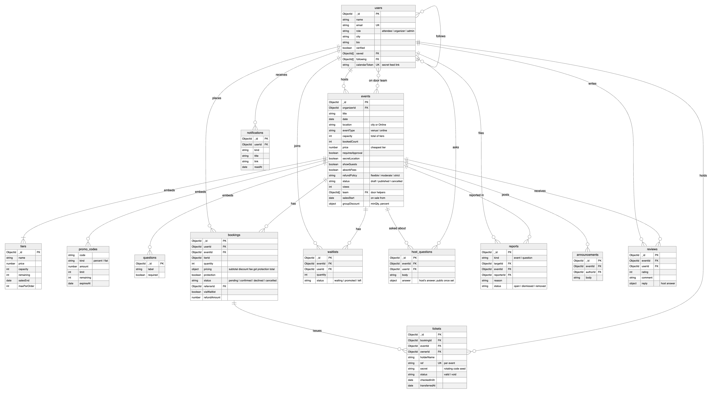
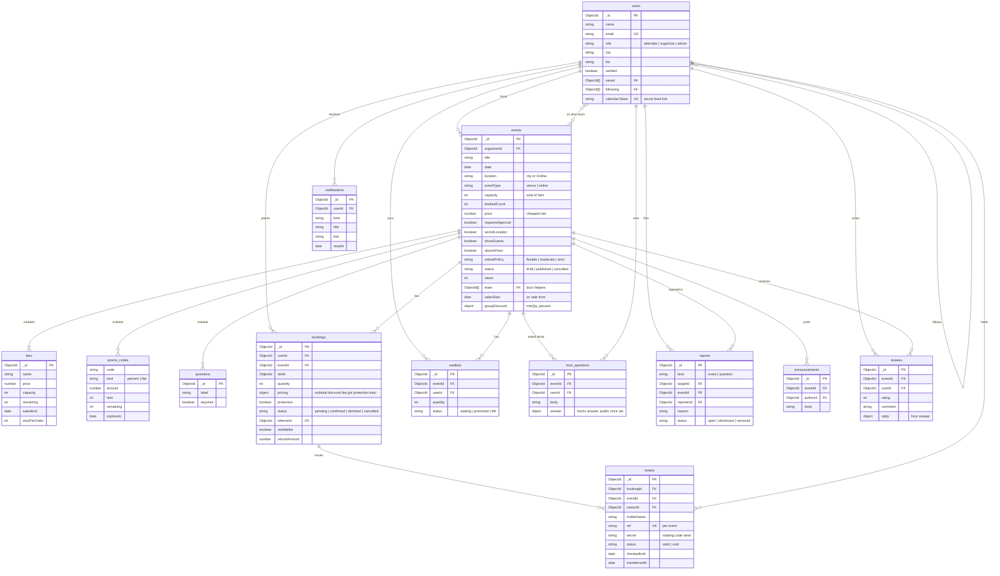

# ER Diagram

The **MongoDB schema** for EventHive v2. An event embeds its ticket tiers, promo codes and questions, so a booking can reserve seats and spend a promo use in one atomic update. A booking is the order; each admission it buys is a ticket, which can change owner when transferred.

Mermaid Source

