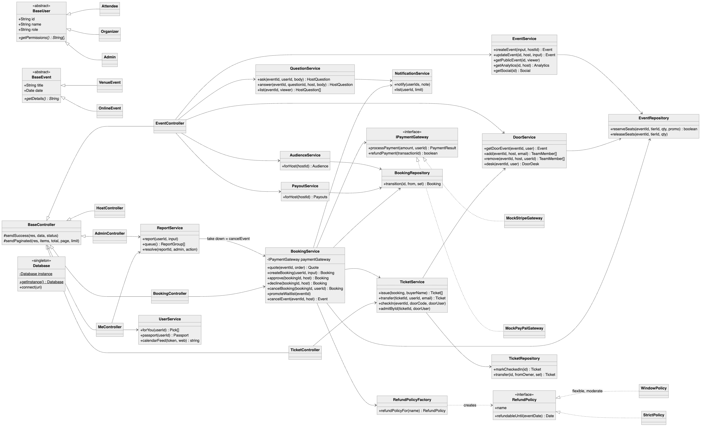
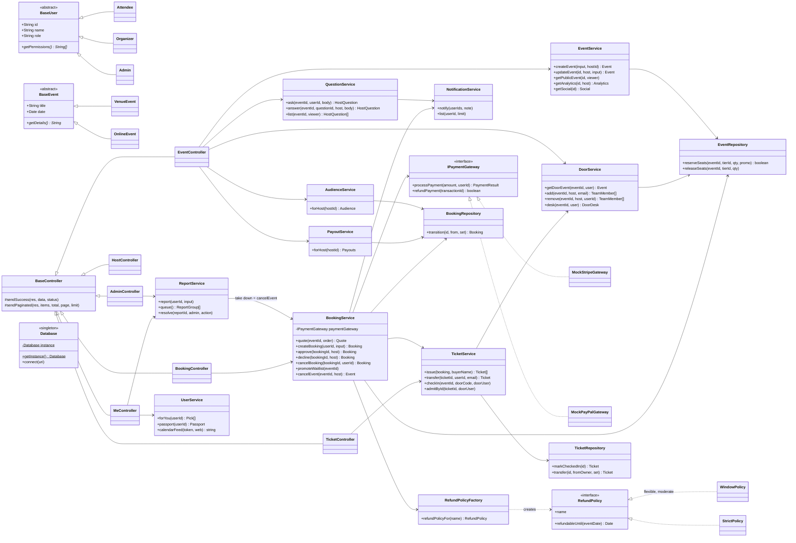

# Class Diagram

The **object-oriented structure** of the EventHive v2 backend: role inheritance, the layered Controller, Service and Repository design, and the design patterns used (Strategy, Factory, Singleton, Repository, and an abstraction over the payment gateway).

Mermaid Source

