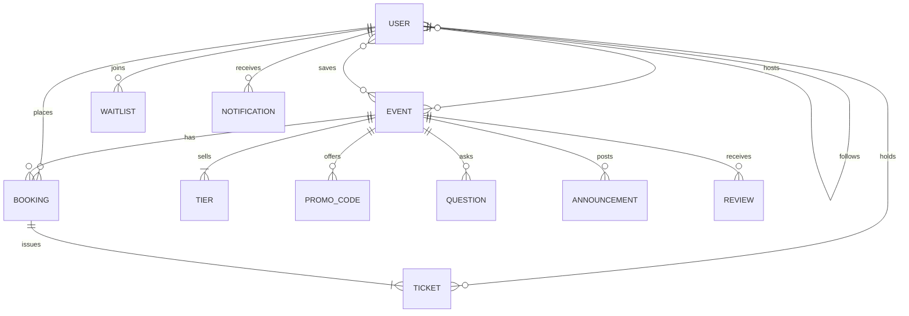
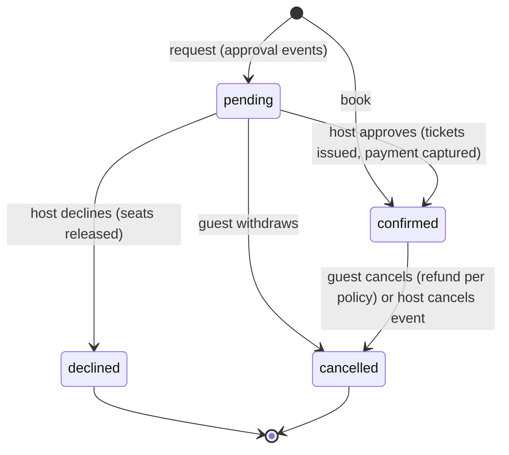

# EventHive v2: features, system design and design system

Built from the [competitor study](research.md). Constraints that still hold: payments are mocked, there is no email or SMS, and the Express backend keeps its Controller, Service, Repository layering.

## 1. Feature brainstorm

Status: **v2** ships in this upgrade, **later** is designed for but not built.

### Ticketing and checkout
| Feature | Inspired by | Status |
|---|---|---|
| Ticket tiers (early bird with a sales end date, general, VIP), each with its own capacity and per-order limit | Eventbrite, Resident Advisor, Townscript | v2 |
| Group booking: several named tickets in one booking | Whova, SeatGeek Parties | v2 |
| Promo codes (percent or flat, usage limit, expiry), auto-applied from a `?code=` link | Tito, Whova | v2 |
| All-in price breakdown: platform fee plus 18% GST on the fee; the host can absorb fees | Ticketmaster, Townscript, KonfHub | v2 |
| Refund policies (flexible, moderate, strict) and a Refund Protection add-on | District, Tito Small Print | v2 |
| Automatic waitlist: when seats free up, the next person is booked in order, respecting party size | Meetup, DICE, Partiful | v2 |
| Approval-required events: request, then approve or decline; seats held meanwhile | Luma, Cvent, Posh | v2 |
| Secret location revealed only to confirmed guests; online join links only to ticket holders | Luma, Secret supper clubs | v2 |
| Custom registration questions | Townscript, KonfHub, Luma | v2 |
| Reserved seat maps | Ticketmaster, BookMyShow | later |
| Virtual waiting room for big on-sales | Ticketmaster Smart Queue, AXS | later |
| Face-value resale marketplace | Ticketmaster, BookMyShow, District | later |
| Demand-based dynamic pricing | Fever, Ticketmaster Platinum | later |
| Add-ons (merch, parking, food) | DICE Extras, BookMyShow F&B | later |

### Tickets and entry
| Feature | Inspired by | Status |
|---|---|---|
| Rotating QR ticket: a 6-digit code that changes every 30 seconds, generated on the device | Ticketmaster SafeTix, AXS Mobile ID, SeatGeek | v2 |
| Ticket transfer to a friend, which re-keys the QR so the old one stops working | BookMyShow, AXS | v2 |
| Check-in desk: camera scan, door code entry, manual admit, live counter | Luma, Eventbrite organizer app | v2 |
| Printable GST invoice per booking | Townscript, KonfHub | v2 |
| Wallet passes and an offline PWA | Ticketmaster, AllEvents | later |
| Staff check-in links, kiosks, badge printing | Tito, Cvent, KonfHub | later |

### Discovery and social
| Feature | Inspired by | Status |
|---|---|---|
| City picker, quick filters (tonight, this weekend, free, under ₹500, online) and sorting | BookMyShow, District | v2 |
| Category stories row | District | v2 |
| Curated collections | Eventbrite It-Lists | v2 |
| Who's going (count and first names) and interested count; the host can hide the guest list | Luma, BookMyShow | v2 |
| Host profiles with follow, ratings and a verified badge | Eventbrite, Luma, AllEvents | v2 |
| Personal referral links and a referrer leaderboard | Whova, Posh, KonfHub | v2 |
| Review wall and host replies to reviews | Meetup, Ticketmaster Fan Reviews | v2 |
| Map view and calendar view | Luma, Fever | later |
| Friends going, contact sync, music-service sync | Eventbrite, DICE, Shotgun | later |

### Communication
| Feature | Inspired by | Status |
|---|---|---|
| In-app notification centre | All of them | v2 |
| Host announcements to ticket holders | Posh, Luma | v2 |
| Automatic alerts: date or venue changed, event cancelled, waitlist promotion, approval decision, ticket received, a followed host's new event, "starts tomorrow" reminder | Eventbrite, Luma, Ticketmaster Watchlist | v2 |
| Email, SMS and WhatsApp delivery | Luma, Posh, BookMyShow | later (out of scope) |

### Organizer tools
| Feature | Inspired by | Status |
|---|---|---|
| Event studio: tiers, promo codes, questions, policies, approval, guest-list visibility | Eventbrite, Tito | v2 |
| Drafts and a pre-publish checklist | Whova Registration Setup Review | v2 |
| Event analytics: sales by day, tier breakdown, check-in rate, top referrers | Cvent, Tito, Whova | v2 |
| Attendee list with requests queue, answers and CSV export | Luma, Cvent | v2 |
| Cancel an event: refund everyone and notify them | Eventbrite | v2 |
| Recurring events, sessions and speakers, AI writing tools | Meetup, Whova, Eventbrite | later |

### Platform
| Feature | Inspired by | Status |
|---|---|---|
| Admin console: platform totals, verify hosts | Original project brief, Eventbrite verified badges | v2 |
| Profile settings: name, home city, host bio | All | v2 |
| `npm run dev` from the repo root; warning when demo data has gone stale | Developer experience | v2 |

## 2. System design

### Domain model



- **Event** embeds its tiers, promo codes and questions, so a booking can reserve seats and spend a promo use in one atomic update. `price`, `capacity` and `bookedCount` are kept as totals across tiers so listing, sorting and badges stay cheap.
- **Booking** is the order: one tier, a quantity, the price breakdown, answers, the referrer and a status. A user has at most one active booking per event, enforced by a partial unique index.
- **Ticket** is one admission. It has an owner (who can change on transfer), a holder name, a 6-letter reference, a secret for the rotating code and a check-in time.
- **Waitlist**, **Notification** and **Announcement** are small collections of their own.

### Booking state machine



Every transition that frees seats then promotes the waitlist: the oldest waiting entry whose party fits is booked automatically and notified. Waitlist bookings come with free Refund Protection, so nobody is stuck with a ticket they no longer want.

### Rotating QR

Each ticket has a random secret that only its owner can read. The owner's browser computes `HMAC-SHA256(secret, floor(now / 30s))` with the Web Crypto API, truncates it to 6 digits (HOTP dynamic truncation, RFC 4226) and renders `EH1:<ref>:<code>` as a QR. The desk accepts the current or previous step, so a screenshot stops working within a minute. Transfer replaces the secret and reference, so the sender's copy dies immediately. Door staff can also type the reference and code.

### Pricing

```
subtotal   = tier price × quantity
discount   = promo (percent or flat, never more than subtotal)
net        = subtotal − discount               ← the host's ticket sales
fee        = 2.5% of net + ₹10 per ticket       (0 for free tickets)
gst        = 18% of fee
protection = 6% of net when chosen              (free for waitlist bookings)
total      = net + protection + (fee + gst unless the host absorbs fees)
```

Refunds: cancelling under the event's policy returns the ticket price (fees are kept). With Refund Protection, everything except the protection fee comes back, up to the start time.

| Policy | Guest can cancel for a refund until |
|---|---|
| Flexible | 24 hours before the start |
| Moderate | 7 days before the start |
| Strict | Never (transfer the ticket instead) |

### API additions

| Area | Endpoints |
|---|---|
| Events | `GET /events?city=&sort=&maxPrice=`, `GET /events/cities`, `POST /events/:id/quote`, `GET /events/:id/social`, `GET /events/:id/analytics`, `POST /events/:id/cancel`, `GET/POST /events/:id/announcements`, `POST/DELETE /events/:id/waitlist`, `GET /events/:id/waitlist` |
| Bookings | `POST /bookings` (tier, quantity, names, promo, protection, answers, referrer), `GET /bookings/:id`, `PATCH /bookings/:id/approve`, `PATCH /bookings/:id/decline` |
| Tickets | `GET /tickets/my`, `POST /tickets/:id/transfer`, `POST /tickets/check-in`, `POST /tickets/:id/admit` |
| People | `GET /hosts/:id`, `GET /hosts`, `GET/PATCH /me`, `PUT/DELETE /me/following/:hostId`, `GET /me/notifications`, `POST /me/notifications/read`, `GET /me/waitlist` |
| Reviews | `PATCH /reviews/:id/reply` |
| Admin | `GET /admin/stats`, `GET /admin/hosts`, `PATCH /admin/hosts/:id` |

### Design patterns used

- **Repository** isolates Mongoose from business logic.
- **Strategy** for discounts (percent and flat) and refund policies (flexible, moderate, strict).
- **Factory** builds the refund policy for an event from its stored name.
- **Singleton** database connection.
- **Abstraction** over the payment gateway (`IPaymentGateway`, mock Stripe and PayPal).

## 3. Design system: Hive Print

**Design read:** consumer event marketplace for India's 18 to 35 going-out crowd, with a bold but polished product feel (Luma and DICE rather than a poster zine), built on native CSS Modules and CSS motion.

**Dials:** variance 7, motion 6, density 4 on marketing pages and 6 on product screens.

| Token | Light | Dark |
|---|---|---|
| Paper / card | `#f6f6f3` / `#ffffff` | `#111113` / `#1b1b1f` |
| Text | `#16161d`, secondary `#45454f`, tertiary `#5f5f6a` | `#f2f2ee`, `#c4c4cc`, `#9a9aa6` |
| Brand (hive yellow) | `#ffd23f` fills with ink text, for the one primary action | same |
| Category colours | music `#ff4fa3`, tech `#3a5bff`, sports `#14b26a`, art `#ff7a29`, food `#f2483b`, business `#6c4cf0`, other `#00a6a6` | same, text uses lighter tints |

- **Type:** Bricolage Grotesque for headlines (condensed at hero size, wider for section titles), Instrument Sans for body and UI, Geist Mono for ticket codes and figures.
- **Shape:** 12px corners on buttons, inputs and cards; 18px on panels and photos; 6px badges; pills only on chips. Hairline borders, soft layered shadows.
- **Photography:** full colour, with the category colour behind it while it loads.
- **Signature details:** ticket stub and tear line, date stamps in the category colour, the hero poster wall, the live ticket's sweeping sheen.
- **Motion:** staggered load-in, scroll reveals, photo morph between card and page, circular theme switch, confetti on booking. All off under `prefers-reduced-motion`.

The first pass used thick ink outlines, hard offset shadows and duotone photos (a gig-poster look). It read as a side project, so v2.1 keeps the colours and type but moves to the quieter surfaces above.
