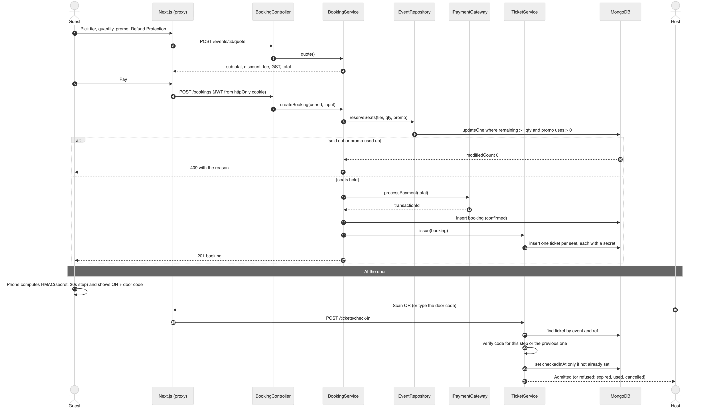
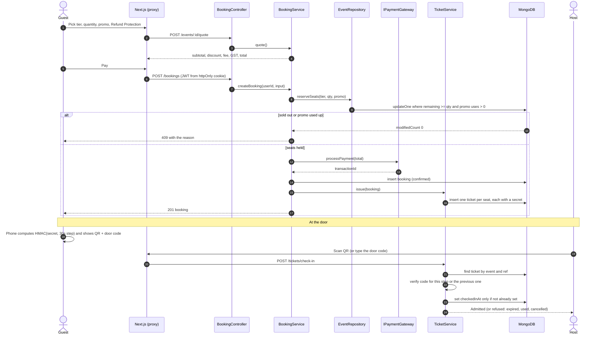

# Sequence Diagram

Two flows from EventHive v2: **booking a ticket** (live quote, atomic seat and promo reservation, payment, tickets) and **getting in at the door** with the rotating QR code.

Mermaid Source

